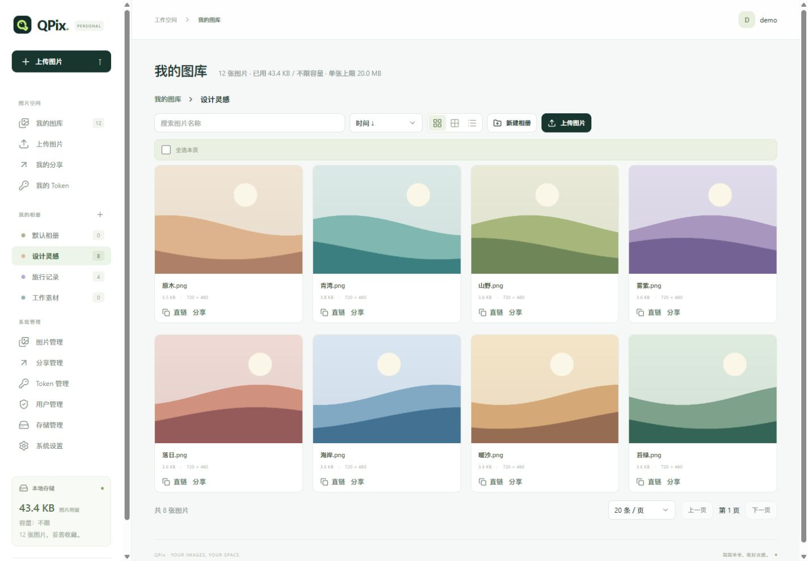
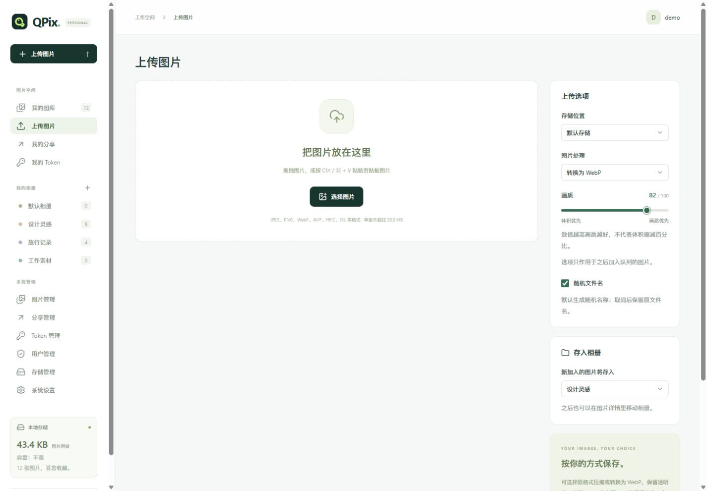
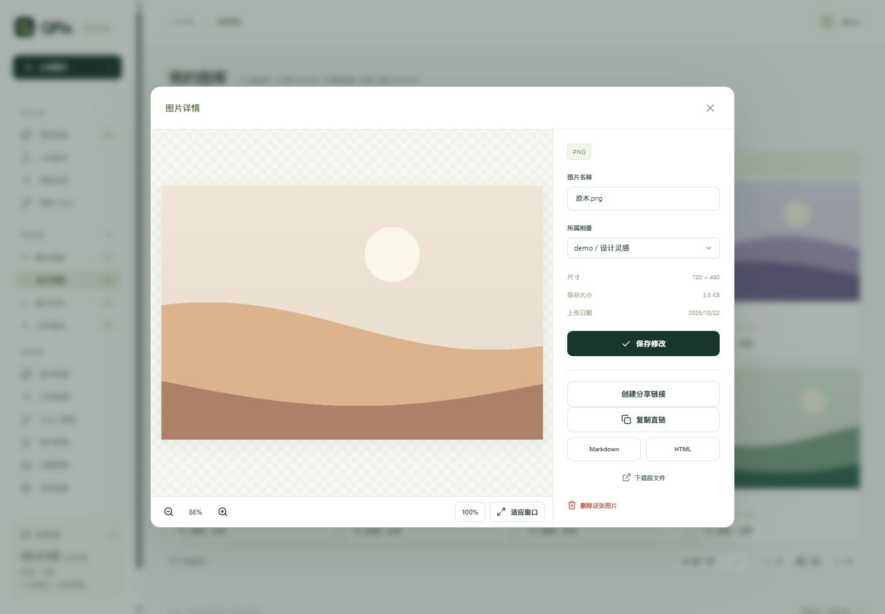
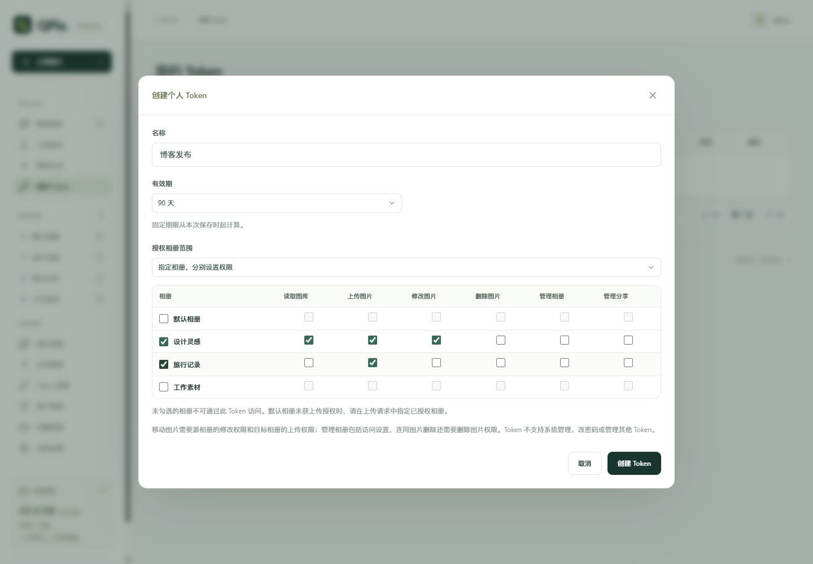
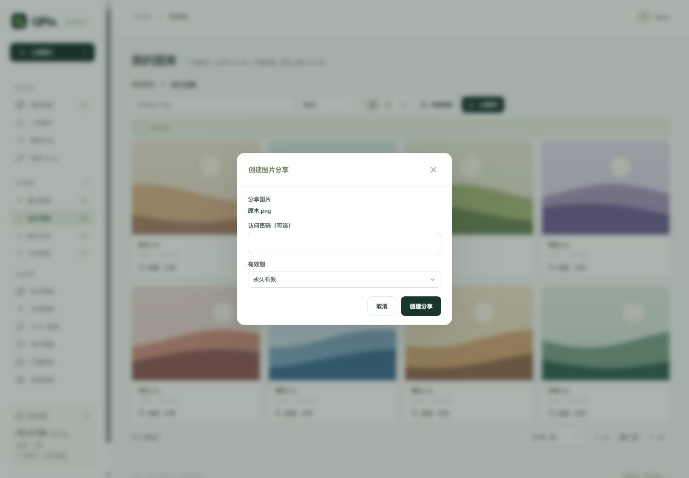
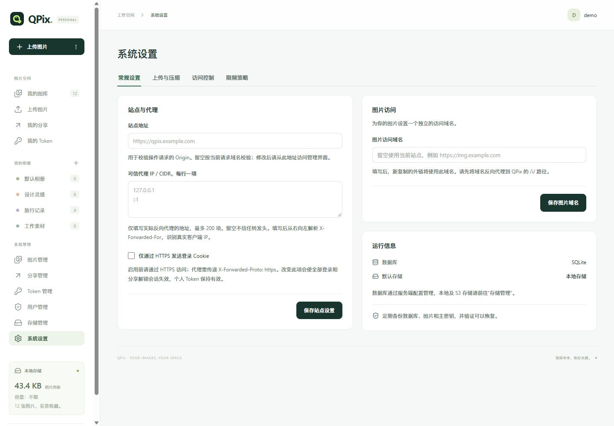
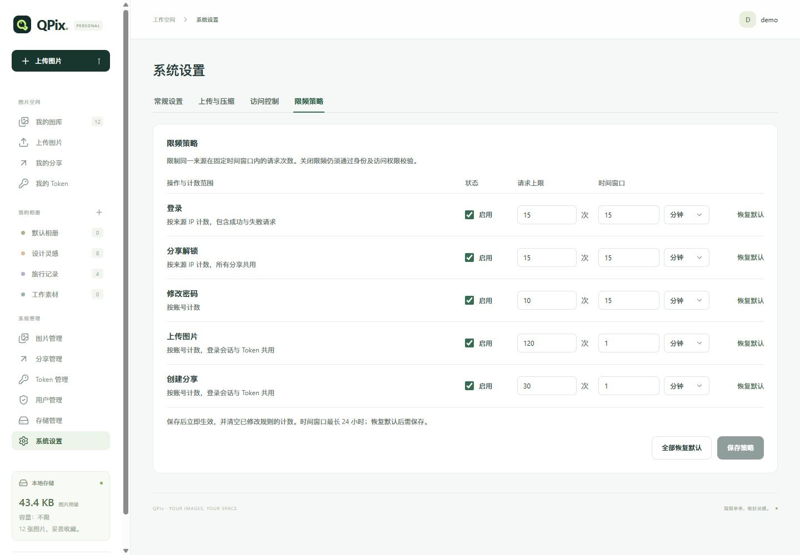

<div align="center">


# QPix

可自托管的轻量图床。用相册整理图片，通过直链或带密码、有效期的链接分享。

[快速部署](#快速部署) · [文档中心](docs/README.md) · [API 参考](docs/api.md) · [下载版本](https://github.com/Qwerto107/QPix/releases)

**Go + Vue** · **SQLite / PostgreSQL / MySQL** · **本地 / S3**

一个容器或一个程序，同时提供页面、API 和图片访问。

</div>

---

## 界面一览

个人图库按相册展示，支持大图标、小图标和详细信息视图。



<details>
<summary><strong>查看更多：上传、预览、分享、权限与系统设置</strong></summary>













截图来自当前开发版，使用独立演示数据，不包含真实凭据。正式版功能以对应 [更新记录](docs/changelog.md) 为准。

</details>

## 功能

| 能力 | 使用方式 |
| --- | --- |
| 图片上传 | 拖拽、选择、粘贴与多图队列，默认随机文件名，支持失败重试，单图一条链接 |
| 相册整理 | 单层相册、可更换默认相册、搜索与排序、批量移动及删除 |
| 图片压缩 | 保留原文件、原格式压缩或转 WebP，画质滑块 1～100，保留透明度 |
| 图片预览 | 大小图标与详细列表，详情支持缩放、100% 原始大小、适应窗口及拖动 |
| 链接分享 | 直链、Markdown、HTML；从图库图片创建单图分享，可设置密码、有效期、撤销及删除记录 |
| 账号与配额 | 统一登录，关闭注册，管理员创建账号，每用户容量和单张上限 |
| 个人 Token | 全部本人相册或逐相册授权，设置操作权限、期限、撤销与清理记录 |
| 多存储 | 多个本地目录和 S3 兼容配置，测试连接、选择默认、上传时切换 |
| 访问控制 | 管理端及直链分别配置 IP／Referer；上传只校验 IP 与身份，相册覆盖 Referer |
| 请求限频 | 分别调整登录、分享解锁、改密、上传和创建分享的启停、次数与时间窗口，保存后生效 |
| 系统管理 | 管理全站图片、分享、Token 和用户；系统设置按常规、上传与压缩、访问控制、限频分类 |

未选择相册时上传至本人默认相册。访客通过图片链接访问，具体权限见 [使用指南](docs/usage.md)。

## 快速部署

推荐使用统一镜像，一个容器提供页面、API 和图片访问。安装 Docker 与 Compose 后，创建运行目录并下载配置，无需克隆源码。

以下权限命令用于 Linux 新建专用目录；已有目录或 Docker Desktop 的权限设置见 [部署指南](docs/deployment.md)。

```sh
mkdir -p qpix/data
sudo chown 65532:65532 qpix/data
sudo chmod 700 qpix/data
cd qpix
curl -fL https://raw.githubusercontent.com/Qwerto107/QPix/main/docker-compose.yml -o docker-compose.yml
```

在 `qpix` 目录新建 `.env`，填写初始管理员密码（非空，最多 72 字节）：

```dotenv
QPIX_ADMIN_PASSWORD='replace-this-password'
```

```sh
docker compose up -d --pull always
```

1. 打开 <http://127.0.0.1:7979>，使用 `admin` 和设置的密码登录。
2. 按需添加相册与存储，在“系统设置”中配置站点、上传与压缩、访问控制及限频规则。
3. 上传图片并复制直链；需要密码或期限时，在图库的图片操作或图片详情中创建分享。

密码只用于首次初始化。数据保存在 `./data`，端口默认仅本机可访问。镜像版本和端口直接在 `docker-compose.yml` 中修改。

Windows、外部数据库、HTTPS 和升级步骤见 [部署指南](docs/deployment.md)。直接运行程序见 [二进制部署](docs/binary.md)，安装包从 [Releases](https://github.com/Qwerto107/QPix/releases) 下载。

## 支持范围

- 支持 JPEG、PNG／APNG、GIF、WebP（含动画）、BMP、TIFF、ICO、AVIF、HEIC／HEIF、静态 JXL 和 SVG。格式压缩与预览范围见 [使用指南](docs/usage.md#压缩细节)。
- 默认单张 20 MiB、2500 万像素，可在后台调整。压缩最多处理 400 万像素，只采用更小的结果，详见 [压缩细节](docs/usage.md#压缩细节)。
- 个人资源按账号隔离。系统管理权限仅用于登录会话，个人 Token 不继承全站权限。
- 原图、预览图、缩略图和分享通过 QPix 网关访问；S3 Bucket 保持私有，图片访问不使用共享 CDN 缓存。
- 当前按单应用实例运行，SQLite 使用本机磁盘；不包含旧图床数据自动迁移、回收站或存储自动迁移。

## 文档导航

| 内容 | 文档 |
| --- | --- |
| 相册、上传、预览与分享 | [使用指南](docs/usage.md) |
| Docker、环境变量、反向代理与升级 | [部署指南](docs/deployment.md) |
| Linux、Windows、macOS 单文件运行 | [二进制部署](docs/binary.md) |
| API 请求、参数与返回值 | [API 参考](docs/api.md) |
| 本地开发、构建与验证 | [开发指南](docs/development.md) |
| 二进制、多架构镜像与自动 Release | [发布流程](docs/releasing.md) |
| 版本变化 | [更新记录](docs/changelog.md) |
